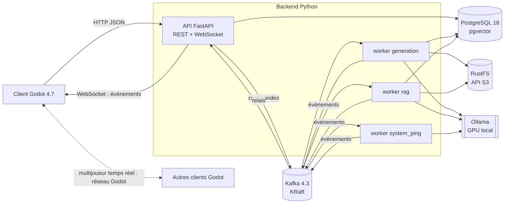

# Architecture

État (2026-10-22) : comptes et rôles, génération (worker `generation`), moteur de partie, lobbies, PNJ,
client Godot (menus, monde 3D) et présence multijoueur en réseau local sont en place. L'ingestion RAG passe
par `.\scripts\ingest.ps1` (pas encore de worker `rag`).

## Briques

| Brique | Rôle | Code |
|---|---|---|
| Client Godot | Menus (formateur, joueur, admin), monde 3D, rendu d'une spec en lobby, PNJ | `godot/` |
| API FastAPI | Point d'entrée unique du client : authentification, rôles, CRUD, publication des commandes, relais WebSocket | `backend/gmix/api` |
| Kafka | Commandes et événements asynchrones, traitements IA, journal des parties | `backend/gmix/messaging` |
| Workers | Consommateurs Kafka : génération, ingestion RAG, simulation | `backend/gmix/workers` |
| PostgreSQL + pgvector | Comptes, lobbies, specs de business games, suivi des générations, corpus RAG (vecteurs + plein texte), catalogue d'assets, cache LLM | `backend/gmix/db` |
| RustFS (S3) | Fichiers : assets 3D, documents sources du RAG, exports | `backend/gmix/storage.py` |
| Ollama | Modèles locaux, appelés uniquement via le catalogue de tâches | `backend/gmix/llm` |

## Flux 1 : le formateur génère un business game

1. Menu formateur (Godot) : domaine, niveau, durée, nombre de joueurs, compétences visées, demande libre.
2. `POST` API -> création de `business_games` + `generation_jobs`, publication sur `gmix.generation.commands`,
   réponse 202 avec l'id du job.
3. Worker de génération : étapes de docs/ai-runtime.md (contrôle de la demande, RAG, plan, phases, PNJ,
   assets, contrôles de cohérence). Chaque étape publie sa progression sur `gmix.generation.events`.
4. L'API relaie ces événements au formateur par WebSocket (barre de progression).
5. Spec validée (schéma + `gmix.game.coherence`) enregistrée ; le formateur relit, régénère une section si
   besoin, publie le lobby et obtient un code d'accès.

## Flux 2 : un joueur parle à un PNJ (latence visible)

1. Message du joueur -> API -> tâche `player.intent` (décision : question métier, décision de jeu,
   hors-sujet, injection).
2. Recherche RAG bornée au domaine -> tâche `npc.dialogue` en streaming renvoyé directement au client.
   Kafka n'est pas sur ce chemin (chaque saut ajoute de la latence) ; la transcription terminée est publiée
   sur `gmix.npc.transcripts` pour l'évaluation et le débrief.

## Flux 3 : partie multijoueur (en salle ou à distance)

- Positions et animations : un serveur Godot headless par lobby, autoritaire, transport ENet en salle ou
  WebSocket sur 443 à distance (docs/decisions/0005). Kafka et FastAPI ne sont pas faits pour 20 à 60 mises
  à jour par seconde.
- Décisions de jeu : l'API applique les règles (`gmix.game.engine`, fonctions pures, sous verrou de ligne
  sur le lobby) et répond tout de suite au joueur ; `lobby.state` sur `gmix.game.events` diffuse l'état aux
  autres membres par WebSocket et garde le journal. Pas de worker de simulation : un calcul de quelques
  microsecondes ne justifie pas un aller-retour Kafka, et le joueur voit l'erreur de règle immédiatement.
- Présence : `POST /lobbies/{id}/presence` lance au besoin le serveur Godot du lobby (`gmix.game.servers`,
  ports GAME_SERVER_PORTS) et remet un ticket de 60 s ; le serveur vérifie sa signature (HS256, JWT_SECRET
  transmis par variable d'environnement) puis relaie les positions à 10 Hz.
- Modes de déploiement : en salle, toute la pile sur une machine du réseau local (`.\scripts\api.ps1 -Lan`) ;
  à distance, sur un serveur derrière un reverse proxy HTTPS. Seuls l'API et les serveurs de partie sont exposés.

## Mondes et assets

L'IA ne crée jamais de géométrie. Un gabarit de carte (`ai/world_templates.yaml`, aujourd'hui
`parc_activites` : une route, huit parcelles typées) expose des zones ; la génération retient les zones de
ses PNJ et le siège, puis choisit pour chacune des ids du catalogue `ai/assets.yaml` (présélection par
similarité vectorielle sur `assets.embedding`, puis choix contraint par un `enum`, repli sur les choix sûrs
du gabarit). L'API envoie le gabarit avec le lobby ; Godot pose le bâtiment au fond de la parcelle, les objets
en rangée devant, les PNJ devant l'entrée. Les fichiers .glb vivent dans le bucket `gmix-assets` et sont
importés dans `godot/assets`.

## Choix structurants

Voir docs/decisions/ : stockage RustFS, Kafka hors temps réel, catalogue de tâches IA.
