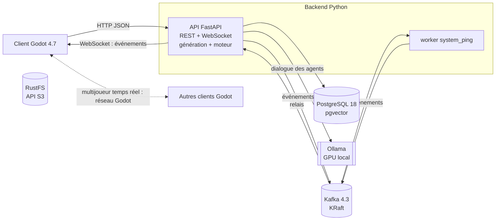

# Architecture

État (2026-10-22) : comptes et rôles, business games simulés générés par paramètres (docs/decisions/0006),
moteur hebdomadaire, lobbies, agents PNJ à mémoire, client Godot (menus, atelier 3D) et présence multijoueur
en réseau local sont en place. L'ingestion RAG passe par `.\scripts\ingest.ps1` (pas de worker `rag`).

## Briques

| Brique | Rôle | Code |
|---|---|---|
| Client Godot | Menus (formateur, joueur, admin), monde 3D, rendu d'une spec en lobby, PNJ | `godot/` |
| API FastAPI | Point d'entrée unique du client : authentification, rôles, CRUD, publication des commandes, relais WebSocket | `backend/gmix/api` |
| Kafka | Commandes et événements asynchrones, traitements IA, journal des parties | `backend/gmix/messaging` |
| Workers | Consommateurs Kafka (aujourd'hui : diagnostic `system_ping`) | `backend/gmix/workers` |
| PostgreSQL + pgvector | Comptes, lobbies et état des parties, specs de business games, mémoire des agents, corpus RAG (vecteurs + plein texte), catalogue d'assets, cache LLM | `backend/gmix/db` |
| RustFS (S3) | Fichiers : assets 3D, documents sources du RAG, exports | `backend/gmix/storage.py` |
| Ollama | Modèles locaux, appelés uniquement via le catalogue de tâches | `backend/gmix/llm` |

## Flux 1 : le formateur génère un business game

1. Menu formateur (Godot) : paramètres de `GET /api/v1/games/options` (secteur, modules, agents, caractère,
   difficulté, semaines, aléas, produits).
2. `POST /api/v1/games` : `gmix.game.generation` assemble la spec (déterministe, sans modèle), la valide
   (`gmix.game.spec.SimSpec`) et la joue en pilote automatique ; réponse 201 en moins d'une seconde.
3. Le formateur relit (partie de référence comprise), crée le lobby et obtient un code d'accès.

## Flux 2 : un joueur parle à un agent (latence visible)

1. Message -> API -> tâche `player.intent` (tev1) : hors-sujet et injection reçoivent une réponse fixe.
2. Faits de la semaine de l'agent (`engine.public_state()["briefings"]`) + six derniers échanges du lobby
   avec lui (`npc_memories`) + extraits RAG pour une question de fond -> tâche `npc.dialogue` -> une ou deux
   phrases. L'échange est enregistré, puis publié sur `gmix.npc.transcripts`. Kafka n'est pas sur ce chemin.

## Flux 3 : partie multijoueur (en salle ou à distance)

- Positions et animations : un serveur Godot headless par lobby, autoritaire, transport ENet en salle ou
  WebSocket sur 443 à distance (docs/decisions/0005). Kafka et FastAPI ne sont pas faits pour 20 à 60 mises
  à jour par seconde.
- Actions et semaines : l'API applique les règles (`gmix.game.engine`, fonctions pures, sous verrou de ligne
  sur le lobby) et répond tout de suite au joueur ; `lobby.state` sur `gmix.game.events` diffuse l'état aux
  autres membres par WebSocket et garde le journal. Pas de worker de simulation : une semaine simulée prend
  quelques millisecondes, et le joueur voit l'erreur de règle immédiatement.
- Présence : `POST /lobbies/{id}/presence` lance au besoin le serveur Godot du lobby (`gmix.game.servers`,
  ports GAME_SERVER_PORTS) et remet un ticket de 60 s ; le serveur vérifie sa signature (HS256, JWT_SECRET
  transmis par variable d'environnement) puis relaie les positions à 10 Hz.
- Modes de déploiement : en salle, toute la pile sur une machine du réseau local (`.\scripts\api.ps1 -Lan`) ;
  à distance, sur un serveur derrière un reverse proxy HTTPS. Seuls l'API et les serveurs de partie sont exposés.

## Mondes et assets

L'IA ne crée jamais de géométrie. La génération place les objets du catalogue `ai/assets.yaml` dans un
atelier de 32 x 24 m repris du jeu de référence (`spec.world` : rayonnages des produits au fond, composants
le long des murs, lignes au centre, poste qualité, bureau, écran des indicateurs, quais et camions devant),
avec les postes d'interaction et les trajets des agents dans les allées libres (vérifiés par les tests).
Godot construit le hall puis anime le décor avec l'état public : remplissage des rayonnages, voyants des
lignes, palettes aux quais, écran des indicateurs, alertes des agents.

## Choix structurants

Voir docs/decisions/ : stockage RustFS, Kafka hors temps réel, catalogue de tâches IA, comptes locaux, jeu
local et distant, business games simulés par paramètres.
